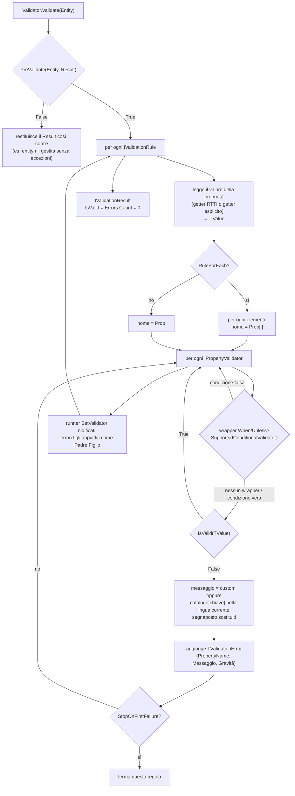

# vmFluentValidator

**Motore di validazione fluent per Delphi / Object Pascal — un porting di [FluentValidation](https://github.com/FluentValidation/FluentValidation) .NET costruito su generics e RTTI.**

[](LICENSE)
[](#versioni-di-delphi)
[](#requisiti)
[](#test)

🇬🇧 *This document is also available [in English](README.md).*

Le regole di validazione si dichiarano una volta sola, in una classe, con una catena fluent
leggibile — invece di spargere `if Trim(Cliente.Nome) = '' then ...` fra form e servizi.

```pascal
RuleFor<string>('Email')
  .NotEmpty
  .EmailAddress(emStrict)
  .WithMessage('{PropertyName} must be a valid company address');
```

---

## Indice

- [In breve](#in-breve)
- [Requisiti](#requisiti)
- [Versioni di Delphi](#versioni-di-delphi)
- [Piattaforme](#piattaforme)
- [Installazione](#installazione)
- [Primi passi](#primi-passi)
- [Architettura](#architettura)
- [Riferimento delle regole](#riferimento-delle-regole)
- [Messaggi e localizzazione](#messaggi-e-localizzazione)
- [Regole condizionali: When / Unless](#regole-condizionali-when--unless)
- [Oggetti nidificati e collezioni](#oggetti-nidificati-e-collezioni)
- [Gravità, cascade e PreValidate](#gravità-cascade-e-prevalidate)
- [Scrivere un validatore proprio](#scrivere-un-validatore-proprio)
- [Esempi](#esempi)
- [Test](#test)
- [Comportamenti noti e trappole](#comportamenti-noti-e-trappole)
- [Divisione delle lingue](#divisione-delle-lingue)
- [Licenza](#licenza)

---

## In breve

- **Catene fluent illimitate.** Ogni metodo di regola restituisce `IRuleBuilderOptions<T, TProp>`,
  quindi la catena si può allungare quanto serve.
- **Niente getter-lambda.** `RuleFor<string>('Nome')` legge il membro via RTTI. Un nome sbagliato
  solleva **alla definizione della regola**, non a validazione avviata.
- **29 validatori inclusi** per stringhe, numeri, date, e-mail, carte di credito, enumerazioni e
  collezioni — più `Must` per tutto il resto.
- **Messaggi localizzati.** I validatori dichiarano una *chiave* di messaggio e segnaposto
  nominali; il testo viene risolto nella lingua corrente. Inglese e italiano sono inclusi;
  aggiungere una lingua è una sottoclasse più una chiamata a `RegisterLanguage`, senza toccare
  la libreria.
- **Oggetti nidificati e collezioni.** `SetValidator` compone i validatori e appiattisce gli
  errori figli come `Padre.Figlio`; `RuleForEach` nomina gli elementi `Collezione[i]`.
- **Regole condizionali** (`When` / `Unless`), **gravità** degli errori (`svError` / `svWarning`),
  **modalità di cascata** e un hook **`PreValidate`**.
- **Nessuna dipendenza.** Solo la RTL. Consumo a livello sorgente, oppure package runtime
  opzionale.

## Requisiti

| | |
|---|---|
| Delphi | **10.4 Sydney o successivo**. Sviluppata con Delphi 13 "Florence"; testata su 13 Florence e 12 Athens. Vedi [Versioni di Delphi](#versioni-di-delphi). |
| Piattaforma | **Win32** e **Win64** — 249 test verdi su entrambe. Vedi [Piattaforme](#piattaforme). |
| Dipendenze | solo RTL — non c'è nient'altro da installare |
| Test | DUnitX (basta la copia inclusa in RAD Studio) |

## Versioni di Delphi

| Versione | Stato |
|---|---|
| 13 Florence (`Studio\37.0`) | **Verificata** — è la versione con cui la libreria viene sviluppata, compilata e testata. |
| 12 Athens (`Studio\23.0`) | **Verificata** — 249 test verdi; libreria, package runtime ed esempi compilati con 12 Athens Community Edition. |
| 11 Alexandria (`Studio\22.0`) | Supportata in base all'analisi dei sorgenti. |
| 10.4 Sydney (`Studio\21.0`) | Supportata in base all'analisi dei sorgenti. |
| 10.3 Rio e precedenti | Non supportate. |

Il minimo lo fissa il linguaggio, non la RTL. La funzionalità di linguaggio più recente usata
nei sorgenti è la **variabile inline** (`var X := ...`, `for var I := ...`), introdotta in 10.3
Rio; il minimo è fissato a 10.4 Sydney perché la prima implementazione delle variabili inline,
in 10.3, aveva bug noti del compilatore. In `src\` non compare nulla di più recente:

- nessuna sintassi di 11 Alexandria (letterali binari, separatori di cifre,
  `TNoRefCountObject`);
- nessuna sintassi o tipo di 12 Athens (stringhe multilinea `'''`, letterali più lunghi di 255
  caratteri, `THashSet<T>`, `TOrderedDictionary<K,V>`);
- nessuna sintassi di 13 Florence (l'espressione `if`, `NameOf`, `is not` / `not in`,
  `noreturn`).

La superficie RTL usata è consolidata da tempo — `System.Rtti` (`TValue`, `TRttiContext`),
`System.Generics.Collections`, `System.RegularExpressions`, `System.SyncObjs`
(`TCriticalSection`), `System.TypInfo`, `System.Character` e gli helper delle stringhe — ed è
tutta disponibile ben prima di 10.4.

Su una versione precedente a 13 Florence, tieni presente che:

- **conviene consumare la libreria a livello sorgente.** I `.dproj` sono stati salvati da 13
  Florence; una IDE più vecchia può chiedere di aggiornarli o segnalare il formato del progetto;
- **gli script di build puntano a `Studio\37.0`.** Cambia `$BDS` in `build.ps1` (o `BDS` in
  `Tests\build_tests.bat`) con la cartella della tua installazione — ad es. `Studio\22.0` per
  11 Alexandria;
- **il package runtime** usa `{$LIBSUFFIX AUTO}`, quindi la BPL prende il nome dalla versione
  del compilatore (`vmFluentValidator370.bpl` su 13 Florence). Se il tuo compilatore rifiuta
  la direttiva, sostituiscila con un suffisso esplicito.

## Piattaforme

La libreria usa soltanto la RTL cross-platform — `System.SysUtils`, `System.Rtti`,
`System.Generics.Collections`, `System.RegularExpressions`, `System.SyncObjs` e affini. In
`src\` non compare nessuna unit `Winapi`, `Vcl` o `FMX`, non c'è assembly inline, non ci sono
cast dipendenti dalla dimensione del puntatore né chiamate ad API di sistema: niente, nel
progetto, la lega a Windows.

| Target | Stato |
|---|---|
| Win32 | **Verificata** — 249 test verdi; package ed esempi compilano. |
| Win64 | **Verificata** — 249 test verdi; package ed esempi compilano. |
| Linux64 | Compila pulito (tutte le unit, `dcclinux64`); il link richiede l'SDK Linux deployato dalla IDE. **Non ancora testata** — gli script di build accettano già `-Platform Linux64`. |
| macOS, Android, iOS | Non testate. Nulla nei sorgenti risulta impedirle. |

Una cautela da tenere presente prima di un porting: `TNumericComparisonValidator` e
`TPrecisionScaleValidator` lavorano attraverso `Extended`, che è a 80 bit solo su Win32 — su
Win64 e su ogni target non-Intel è un alias di `Double`. Il conteggio delle cifre decimali in
`TPrecisionScaleValidator` (tolleranza `1E-9`) è quindi l'unico punto in cui il comportamento
può divergere ai limiti di precisione. La suite passa su Win32 e Win64 così com'è.

## Installazione

### A livello sorgente (consigliato)

Aggiungi queste due cartelle allo *unit search path* del tuo progetto:

```
<repo>\src
<repo>\src\Validators
```

poi `uses FluentValidator, FluentValidator.Intf, FluentValidator.Validators;`.
`FluentValidator.Validators` è l'aggregatore: tira dentro tutti i validatori inclusi e il pacchetto
lingua italiano, e dichiara gli alias brevi (`TNotNull`, `TEmail`, …) su cui è scritto il motore.

### Come package runtime (opzionale)

`Packages\vmFluentValidator.dpk` è un package solo-runtime (`{$RUNONLY}`, `requires rtl`) che
contiene tutte e 35 le unit. Non registra nulla, quindi non esiste un package design-time.

```powershell
cd Packages
.\build.ps1                     # vmFluentValidator370.bpl + .dcp in Win32\Release
.\build.ps1 -Platform Win64     # lo stesso, sotto Win64\Release
```

## Primi passi

```pascal
uses
  System.SysUtils,
  FluentValidator.Intf,
  FluentValidator,
  FluentValidator.Messages,
  FluentValidator.Validators;

type
  TCustomer = class
  public
    Name: string;
    Surname: string;
    Age: Integer;
    Email: string;
  end;

  TCustomerValidator = class(TValidator<TCustomer>)
  public
    constructor Create;
  end;

constructor TCustomerValidator.Create;
begin
  inherited Create;

  // Forma RTTI: basta il nome del membro, niente getter-lambda e nessuna
  // duplicazione fra nome e getter.
  RuleFor<string>('Name')
    .NotEmpty
    .Length(2, 50);

  RuleFor<Integer>('Age')
    .InclusiveBetween(18, 120)
    .WithMessage('{PropertyName} must be between {From} and {To} years');

  RuleFor<string>('Email')
    .NotEmpty
    .EmailAddress(emStrict);
end;
```

```pascal
var
  Validator: IValidator<TCustomer>;
  Res: IValidationResult;
  Error: IValidationError;
begin
  Validator := TCustomerValidator.Create;   // refcounted: NON va liberato
  Res := Validator.Validate(Customer);

  if not Res.IsValid then
    for Error in Res.Errors do
      Writeln(Error.PropertyName, ': ', Error.ErrorMessage);
end;
```

Output per un cliente non valido:

```
Name: Name must be between 2 and 50 characters long
Age: Age must be between 18 and 120 years
Email: Email is not a valid email address
```

> **Due idiomi di lifetime, da non mescolare sulla stessa istanza.** Assegnare a `IValidator<T>`
> è reference-counted e **non** va liberato. Tenere un riferimento di classe `TValidator<T>`
> significa possederlo (`try..finally Free`) — ed è l'unico stile in cui `StopOnFirstFailure` e
> `Cascade` si concatenano, perché restituiscono il tipo classe.

## Architettura

Cinque livelli. Ognuno conosce quello sopra soltanto attraverso le interfacce.

```
┌──────────────────────────────────────────────────────────────────────────────────────┐
│ IL TUO CODICE                                                                        │
│                                                                                      │
│   TCustomer                       TCustomerValidator = class(TValidator<T>)          │
│   classe normale; i membri          constructor Create;                              │
│   public hanno RTTI di default        RuleFor<string>('Name').NotEmpty.Length(2, 50);│
└──────────────────────────────────────────────────────────────────────────────────────┘
                                      │  Validate(Entity): IValidationResult
                                      ▼
┌──────────────────────────────────────────────────────────────────────────────────────┐
│ 1. CONTRATTI      src\FluentValidator.Intf.pas                                       │
│                                                                                      │
│   IValidator<T> ................ Validate(Entity): IValidationResult                 │
│   IRuleBuilder<T,TProp> ........ l'intera superficie fluent (NotEmpty, MaxLength...) │
│   IRuleBuilderOptions<T,TProp> . aggiunge WithMessage / WithSeverity / Cascade       │
│   IValidationRule .............. CONFINE DI TYPE ERASURE: nasconde TProp al motore   │
│   IPropertyValidator ........... un controllo foglia su un TValue non tipizzato      │
│   IValidationResult / IValidationError / TCascadeMode / TValidationSeverity          │
└──────────────────────────────────────────────────────────────────────────────────────┘
                                      │  implementati da
                                      ▼
┌──────────────────────────────────────────────────────────────────────────────────────┐
│ 2. MOTORE         src\FluentValidator.pas                                            │
│                                                                                      │
│   TAbstractValidator<T>   possiede TList<IValidationRule> + un TRttiContext duraturo │
│     RuleFor<TProp>(Nome) ......... getter RTTI; fallisce subito su membro inesistente│
│     RuleFor<TProp>(Nome, Getter) . getter esplicito (T non classe, valori calcolati) │
│     RuleForEach<TItem>(Nome, Get)  regole per elemento; errori Collezione[i]         │
│     RuleForObject(Nome) .......... getter identita' -> .Must cross-field             │
│                                                                                      │
│   TRuleBuilder<T,TProp>   UN SOLO oggetto che e' insieme il builder fluent E la      │
│                           regola eseguibile (IRuleBuilder + IValidationRule)         │
│                                                                                      │
│   TValidator<T>           la classe da sottoclassare: StopOnFirstFailure globale,    │
│                           Cascade(modo), hook PreValidate(Entity, Result)            │
│                                                                                      │
│   TBaseValidator          base di ogni validatore foglia:                            │
│                           IsValid(TValue) + GetMessageKey [+ GetMessageArgs]         │
└──────────────────────────────────────────────────────────────────────────────────────┘
                                      │  ogni controllo foglia gira su un TValue
                                      ▼
┌──────────────────────────────────────────────────────────────────────────────────────┐
│ 3. VALIDATORI FOGLIA   src\Validators\   (29 unit, una classe per unit)              │
│                                                                                      │
│   TNotNullValidator  TNotEmptyValidator  TLengthValidator  TRegexValidator  ...      │
│                                                                                      │
│   TNumericComparisonValidator   riceve una closure TNumericComparator e gestisce     │
│     GreaterThan, LessThan,      UNA VOLTA SOLA l'estrazione ordinale/float per       │
│     InclusiveBetween, ...       tutti i validatori numerici                          │
│                                                                                      │
│   TWhenValidator / TUnlessValidator   l'eccezione strutturale: DECORA un altro       │
│     IPropertyValidator ed espone IConditionalValidator, che il motore riconosce      │
│     con Supports(...) in TRuleBuilder.ShouldRunValidator                             │
└──────────────────────────────────────────────────────────────────────────────────────┘
                                      │  un controllo fallito chiede il suo messaggio
                                      ▼
┌──────────────────────────────────────────────────────────────────────────────────────┐
│ 4. MESSAGGI       src\FluentValidator.Messages.pas                                   │
│                                                                                      │
│   TValidationMessageKeys   le chiavi che un validatore dichiara (TMsgKey.MaxLength)  │
│   TValidationMessages      Args / Render / Build / BuildCustom                       │
│   TValidationLanguage      una lingua: FillTemplates ne riempie i template           │
│   TValidationLanguages     registro globale thread-safe + Culture corrente           │
│                                                                                      │
│   en -> TEnglishLanguage, definita qui: e' sempre linkata ed e' il fallback          │
│         di ogni altra lingua                                                         │
│   it -> src\FluentValidator.Language.Italian.pas, si autoregistra all'avvio          │
│                                                                                      │
│   Ricerca: lingua corrente -> lingua neutra -> inglese -> la chiave stessa           │
└──────────────────────────────────────────────────────────────────────────────────────┘
                                      │  tutto viene messo insieme da
                                      ▼
┌──────────────────────────────────────────────────────────────────────────────────────┐
│ 5. AGGREGATORE    src\FluentValidator.Validators.pas                                 │
│                                                                                      │
│   usa tutte le unit dei validatori + il pacchetto lingua italiano, e dichiara gli    │
│   alias brevi (TNotNull, TEmail, TWhen, ...) su cui e' scritto TRuleBuilder.         │
└──────────────────────────────────────────────────────────────────────────────────────┘
```

### Cosa succede durante `Validate`



## Riferimento delle regole

Tutto quello che segue è un metodo di `IRuleBuilder<T, TProp>` e restituisce
`IRuleBuilderOptions<T, TProp>`, quindi è concatenabile.

### Presenza

| Metodo | Passa quando |
|---|---|
| `NotNull` | il valore è assegnato; per una proprietà oggetto, il riferimento non è `nil` |
| `Null` | il valore non è assegnato, oppure il riferimento all'oggetto è `nil` |
| `NotEmpty` | stringa non vuota dopo `Trim`; numero ≠ 0; oggetto ≠ `nil` |
| `Empty` | l'esatto contrario di `NotEmpty` |
| `NotEmptyCollection` | array dinamico di lunghezza > 0, oppure proprietà `Count` dell'oggetto > 0 — funziona con `TArray<T>`, `TList<T>`, `TObjectList<T>`, `TDictionary<K,V>`, `TStringList`, … |

### Stringhe

| Metodo | Note |
|---|---|
| `Length(Min, Max)` | numero di caratteri, estremi inclusi |
| `MinLength(n)` / `MaxLength(n)` | |
| `Equal(s)` / `NotEqual(s)` | esiste anche l'overload per `Integer` |
| `Matches(Pattern)` | `System.RegularExpressions.TRegEx.IsMatch` |
| `StartsWithUpperCase` | gestisce le lettere accentate (`É`, `Ò`, …) |
| `StartsWithUpperCaseWithMessage(Msg)` | idem, con il messaggio inline |

### Numeri

| Metodo | Note |
|---|---|
| `GreaterThan(n)` / `GreaterThanOrEqual(n)` | |
| `LessThan(n)` / `LessThanOrEqual(n)` | |
| `InclusiveBetween(Min, Max)` | segnaposto `{From}` `{To}` |
| `ExclusiveBetween(Min, Max)` | segnaposto `{From}` `{To}` |
| `PrecisionScale(Precision, Scale)` | cifre totali e cifre decimali |

Tutti condividono `TNumericComparisonValidator`, che estrae il numero una volta sola e quindi
accetta indifferentemente `Integer`, `Int64`, `Cardinal`, `Word`, `Byte`, `SmallInt`,
`ShortInt`, `Single`, `Double` e `Currency`.

### Date

| Metodo | Note |
|---|---|
| `MustBeInPast(IncludeToday = False)` | confronta per **giorno di calendario** (`Trunc`), quindi l'esito non dipende dall'ora in cui si esegue il controllo |
| `MustBeInFuture(IncludeToday = False)` | idem |

### E-mail, carte, enumerazioni

| Metodo | Note |
|---|---|
| `Email` | permissivo (`emSimple`), stringa vuota **non** ammessa — default storico, mantenuto per compatibilità |
| `EmailWithAllowEmpty(AllowEmpty)` | severo (`emStrict`) |
| `EmailAddress(Mode = emSimple; AllowEmpty = False)` | scelta esplicita di entrambi |
| `CreditCard` | checksum di Luhn; spazi e trattini vengono rimossi |
| `IsInEnum(TypeInfo(TMioEnum))` | accetta l'ordinale o il nome (case-insensitive) |
| `IsEnumName(TypeInfo(TMioEnum); CaseSensitive = False)` | solo il nome |

### Tutto il resto

```pascal
RuleFor<string>('Name')
  .Must(
    function(Value: string): Boolean
    begin
      Result := (Value = '') or not CharInSet(Value[1], ['0'..'9']);
    end,
    '{PropertyName} must not start with a digit');
```

### Opzioni

| Metodo | Effetto |
|---|---|
| `WithMessage(Msg)` | sostituisce il messaggio **del solo ultimo validatore aggiunto** |
| `WithSeverity(sv)` | `svError` (default) o `svWarning`, anch'esso solo sull'ultimo validatore |
| `StopOnFirstFailure` | ferma questa regola al primo fallimento |
| `Cascade(cmStop \| cmContinue)` | forma esplicita e simmetrica della precedente |

## Messaggi e localizzazione

Nessun validatore contiene il testo del messaggio. Dichiara una **chiave** e, se il template ha
segnaposto, gli **argomenti nominali** per riempirli:

```pascal
function TMaxLengthValidator.GetMessageKey: string;
begin
  Result := TMsgKey.MaxLength;
end;

function TMaxLengthValidator.GetMessageArgs: TMessageArgs;
begin
  Result := TValidationMessages.Args(['MaxLength', FMaxLength]);
end;
```

Il testo viene risolto nella lingua corrente:

```pascal
TValidationLanguages.Culture := 'it';       // va bene anche 'it-IT': la regionale ricade sulla neutra
TValidationLanguages.Culture := 'en';       // ritorno al default
```

L'ordine di ricerca è *lingua corrente → lingua neutra → inglese → la chiave stessa*: una lingua
tradotta solo in parte non fa mai sparire un messaggio, e una chiave nuova resta riconoscibile.

Aggiungere una lingua propria senza toccare la libreria:

```pascal
type
  TFrenchLanguage = class(TValidationLanguage)
  protected
    procedure FillTemplates; override;
  end;

procedure TFrenchLanguage.FillTemplates;
begin
  Add(TMsgKey.NotEmpty,  '{PropertyName} ne peut pas être vide');
  Add(TMsgKey.MaxLength, '{PropertyName} ne peut pas dépasser {MaxLength} caractères');
  // … le chiavi che ometti ricadono sull'inglese
end;

// da qualche parte all'avvio
TValidationLanguages.RegisterLanguage(TFrenchLanguage.Create('fr'));
TValidationLanguages.Culture := 'fr';
```

`TValidationLanguages` è un registro globale thread-safe (`RegisterLanguage`, `IsRegistered`,
`RegisteredCultures`, `Culture`).

### `WithMessage` accetta due stili, di proposito

| Stile | Esempio | Comportamento |
|---|---|---|
| **Segnaposto nominali** (consigliato) | `'{PropertyName} must not exceed {MaxLength}'` | `{PropertyName}` è sempre disponibile, più i segnaposto del validatore stesso. Un `%` letterale è innocuo. |
| Posizionale (storico) | `'%s is required'` | Ricade su `Format(Msg, [PropertyName])`. Mantenuto perché il codice consumer esistente lo usa — ma un `%` letterale di troppo **solleva**. |

La regola è semplice: se la stringa contiene `{`, passa dalla sostituzione nominale.

### Chiavi dei messaggi

`Generic`, `NotNull`, `Null`, `NotEmpty`, `Empty`, `CollectionNotEmpty`, `Length`, `MaxLength`,
`MinLength`, `Equal`, `NotEqual`, `GreaterThan`, `GreaterThanOrEqual`, `LessThan`,
`LessThanOrEqual`, `InclusiveBetween`, `ExclusiveBetween`, `PrecisionScale`, `Regex`,
`StartsWithUpperCase`, `Email`, `CreditCard`, `MustBeInPast`, `MustBeInPastOrToday`,
`MustBeInFuture`, `MustBeInFutureOrToday`, `EnumValue`, `EnumValueReceived`, `EnumName`,
`EnumNameReceived`, `Predicate`, `Conditional`.

## Regole condizionali: When / Unless

```pascal
RuleFor<Integer>('ScontoPercentuale')
  .When(
    function(F: TFattura): Boolean
    begin
      Result := F.RegimeFiscale = rfForfettario;
    end)
  .Equal(0)
  .WithMessage('{PropertyName} is not allowed under the flat-rate scheme');
```

La condizione riceve **l'intera entità**, non la sola proprietà.

> ⚠️ **`.When` / `.Unless` vanno *prima* delle regole che devono condizionare.** Impostano solo la
> condizione corrente; vengono avvolti solo i validatori aggiunti *dopo*. `.When(c).NotEmpty`
> funziona — `.NotEmpty.When(c)` non fa silenziosamente nulla.

> ⚠️ **Le condizioni sono "sticky".** Una volta impostata, la condizione si applica a ogni
> validatore successivo della stessa catena `RuleFor`. È voluto ed è fissato da un test: per
> lasciarsi alle spalle una condizione, apri una nuova catena `RuleFor`.

Internamente `TWhenValidator` *decora* un altro `IPropertyValidator` ed espone
`IConditionalValidator`; il motore lo riconosce con `Supports(...)` e salta il controllo interno
quando la condizione è falsa. `TUnlessValidator` è lo stesso con la condizione negata.

## Oggetti nidificati e collezioni

### `SetValidator` — comporre i validatori

```pascal
RuleFor<TIndirizzo>('Indirizzo',
  function(P: TPersona): TIndirizzo begin Result := P.Indirizzo; end)
  .SetValidator(IndirizzoValidator);   // un IValidator<TIndirizzo>
```

Gli errori figli vengono appiattiti nel risultato del padre con il nome `'Padre.Figlio'`:

```
Indirizzo.CAP: CAP must not be empty
```

Un oggetto nidificato `nil` viene **saltato** (come in .NET). Se la presenza è obbligatoria,
aggiungi un `.NotNull` esplicito.

### `RuleForEach` — una regola per elemento

```pascal
RuleForEach<TRigaFattura>('Righe',
  function(F: TFattura): TEnumerable<TRigaFattura> begin Result := F.Righe; end)
  .SetValidator(RigaFatturaValidator);
```

Gli errori sono nominati per indice, e si combinano con la nidificazione:

```
Righe[1].Descrizione: Descrizione must not be empty
```

Una collezione vuota è valida.

## Gravità, cascade e PreValidate

```pascal
RuleFor<string>('Note')
  .MaxLength(500)
  .WithSeverity(svWarning);
```

> ⚠️ **La gravità non influisce sulla validità.** `IValidationResult.IsValid` è
> `Errors.Count = 0`, quindi un errore `svWarning` rende comunque il risultato non valido.
> Filtrare per gravità è compito del consumatore:

```pascal
for Error in Res.Errors do
  if Error.Severity = svError then
    MostraErroreBloccante(Error)
  else
    MostraAvviso(Error);
```

La cascata si imposta per regola (`.Cascade(cmStop)` / `.StopOnFirstFailure`) oppure globalmente
sul validatore:

```pascal
var V := TValidator<TCustomer>.Create;
try
  V.Cascade(cmStop);      // si ferma alla prima regola che fallisce
  ...
finally
  V.Free;
end;
```

`PreValidate` è la modalità documentata per rifiutare in modo pulito un'entity `nil`, evitando
che il sistema vada in errore all'interno della RTTI. Restituisci `False` per interrompere
l'esecuzione e restituire il risultato così com'è:

```pascal
function TCustomerValidator.PreValidate(Entity: TCustomer;
  AResult: IValidationResult): Boolean;
begin
  if Entity = nil then
  begin
    AResult.AddError('Customer', 'Customer cannot be nil');
    Exit(False);
  end;
  Result := True;
end;
```

## Scrivere un validatore proprio

Un validatore foglia sottoclassa `TBaseValidator` e implementa `IsValid` più `GetMessageKey`
(e `GetMessageArgs` quando il messaggio ha segnaposto):

```pascal
unit FluentValidator.EvenNumberValidator;

interface

uses
  System.Rtti, FluentValidator.Intf, FluentValidator, FluentValidator.Messages;

type
  TEvenNumberValidator = class(TBaseValidator)
  protected
    function GetMessageKey: string; override;
  public
    function IsValid(const Value: TValue): Boolean; override;
  end;

implementation

function TEvenNumberValidator.IsValid(const Value: TValue): Boolean;
begin
  if Value.IsEmpty or not Value.IsOrdinal then
    Exit(False);
  Result := Value.AsOrdinal mod 2 = 0;
end;

function TEvenNumberValidator.GetMessageKey: string;
begin
  Result := 'EvenNumber';
end;

end.
```

**Agganciare un validatore nuovo tocca 6 punti:**

1. la nuova unit sotto `src\Validators\`;
2. la clausola `uses` **e** l'alias breve in `src\FluentValidator.Validators.pas`;
3. il metodo su `IRuleBuilder<T, TProp>` in `src\FluentValidator.Intf.pas`;
4. la sua implementazione su `TRuleBuilder<T, TProp>` in `src\FluentValidator.pas`;
5. la clausola `uses` di `Tests\FluentValidatorTests.dpr`, che elenca esplicitamente ogni unit
   sorgente con `in '..\src\...'`;
6. *(solo se usi il package)* la clausola `contains` di `Packages\vmFluentValidator.dpk` e il
   corrispondente `DCCReference` nel suo `.dproj`.

**Un messaggio nuovo ne tocca altri 3:** la chiave in `TValidationMessageKeys`, il template
inglese in `TEnglishLanguage.FillTemplates` e quello italiano in
`TItalianLanguage.FillTemplates`. Dimenticare una traduzione non è grave (ricade sull'inglese);
dimenticare il template inglese significa che la chiave grezza finisce a video come messaggio.

## Esempi

| Progetto | Cosa mostra |
|---|---|
| `Examples\Example1.dpr` | **Primi passi**: la forma RTTI di `RuleFor`, la stampa del risultato, il cambio di lingua dei messaggi. |
| `Examples\Example2.dpr` | La forma con getter esplicito di `RuleFor`, la catena numerica completa, `Must`, e una regola cross-field scritta con `RuleForObject`. |
| `Examples\Example3_VerificaModifiche.dpr` | Banco di verifica end-to-end (dominio fattura elettronica): ogni sezione isola un comportamento, dichiara l'esito atteso e stampa `[OK]` / `[DIFFORME]`. Utile come smoke test di non-regressione. |

Si compilano tutti da riga di comando, senza aprire la IDE:

```powershell
cd Examples
.\build.ps1                    # tutti e tre, Win32
.\build.ps1 -Only Example1     # uno solo
.\build.ps1 -Platform Win64    # tutti e tre, Win64
.\Win32\Debug\Example1.exe
```

Oppure apri un qualsiasi `.dproj` in RAD Studio e premi F9.

## Test

249 test DUnitX, tutti verdi. La suite compila contro la copia di DUnitX inclusa in RAD Studio
(`$(BDS)\source\DUnitX`), quindi non serve installare nulla via GetIt.

```powershell
cd Tests
.\build.ps1                    # Win32 (default)
.\Win32\Debug\FluentValidatorTests.exe --exitbehavior:continue

.\build.ps1 -Platform Win64    # oppure Win64
.\Win64\Debug\FluentValidatorTests.exe --exitbehavior:continue
```

Per eseguire un singolo test, o un'intera fixture per prefisso:

```powershell
.\Win32\Debug\FluentValidatorTests.exe --run:Test.Core.TTestCore.WithMessage_SostituisceIlMessaggioDiDefault --exitbehavior:continue
.\Win32\Debug\FluentValidatorTests.exe --run:Test.WhenUnless.TTestWhenUnless --exitbehavior:continue
```

Vedi [`Tests/README.md`](Tests/README.md) per la struttura della suite e le sue convenzioni.

## Comportamenti noti e trappole

Sono scelte deliberate, fissate dai test. Cambiarne una significa aggiornare consapevolmente il
test corrispondente.

- **La policy sui tipi non gestiti non è uniforme.** La maggior parte dei validatori restituisce
  `False` per un tipo che non sa trattare, ma `TNotEmptyValidator` e
  `TCollectionNotEmptyValidator` restituiscono `True`, e `TNotEqualValidator` restituisce `True`
  su valore vuoto.
- **`Must` tratta un `TValue` vuoto come `Default(TProp)`** invece di fallire: il predicato viene
  sempre chiamato.
- **`WithMessage` / `WithSeverity` valgono solo per l'ultimo validatore aggiunto**, sbrogliando
  il decoratore `When`/`Unless` per raggiungere quello interno.
- **`.Email` è permissivo, `.EmailWithAllowEmpty` è severo.** Denominazione storica, mantenuta
  per compatibilità. Usa `.EmailAddress(Mode, AllowEmpty)` quando vuoi essere esplicito.
- **La gravità non influisce sulla validità** (vedi sopra).
- **Ogni interfaccia nuova vuole un GUID nuovo.** Un GUID duplicato fra `IConditionalValidator` e
  `IPropertyValidator` ha rotto, una volta, `Supports()` per *tutti* i validatori; c'è un test di
  non-regressione che lo fissa.
- **Mai scrivere `{` dentro un commento a blocco `{...}`.** I commenti a blocco di Delphi non si
  annidano, quindi un `{PropertyName}` scritto lì dentro chiude il commento in anticipo e la unit
  non compila più, con errori poco comprensibili. Usa commenti `//`, oppure descrivi il segnaposto
  a parole.
- **I sorgenti che contengono caratteri accentati vogliono il BOM UTF-8**, altrimenti `dcc32` li
  legge nella codepage ANSI di sistema.
- **Sui target a 64 bit `Length()` restituisce `NativeInt`**: `Assert.AreEqual(0, Length(X))`
  non riesce più a inferire un unico tipo generico e non compila. La suite usa un cast
  esplicito: `Assert.AreEqual(0, Integer(Length(X)))`. Mantienilo quando aggiungi un test.

## Divisione delle lingue

Tutto ciò che un utente finale può vedere — messaggi di validazione, messaggi delle eccezioni — è
in **inglese**. Commenti, nomi dei metodi di test e prosa di documentazione interna sono in
**italiano**. Se contribuisci, per favore mantieni questa divisione.

## Licenza

Distribuito con **Apache License, Version 2.0**. Il testo completo è nel file
[`LICENSE`](LICENSE), oppure su <http://www.apache.org/licenses/LICENSE-2.0>.

```
Copyright 2025-2026 Muzio Valerio

Licensed under the Apache License, Version 2.0 (the "License");
you may not use this file except in compliance with the License.
You may obtain a copy of the License at

    http://www.apache.org/licenses/LICENSE-2.0

Unless required by applicable law or agreed to in writing, software
distributed under the License is distributed on an "AS IS" BASIS,
WITHOUT WARRANTIES OR CONDITIONS OF ANY KIND, either express or implied.
See the License for the specific language governing permissions and
limitations under the License.
```
