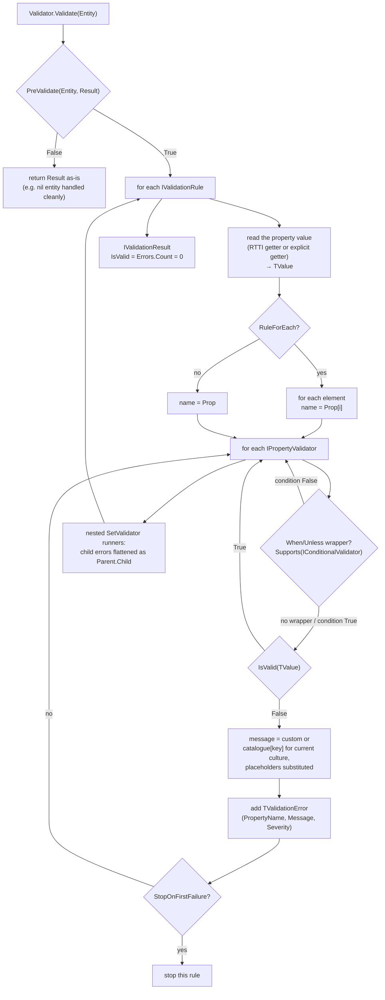

# vmFluentValidator

**A fluent validation engine for Delphi / Object Pascal — a port of .NET's [FluentValidation](https://github.com/FluentValidation/FluentValidation) built on generics and RTTI.**

[](LICENSE)
[](#delphi-versions)
[](#requirements)
[](#tests)

🇮🇹 *Questo documento è disponibile anche [in italiano](README.it.md).*

Declare your validation rules once, in a class, with a readable fluent chain — instead of
scattering `if Trim(Customer.Name) = '' then ...` across your forms and services.

```pascal
RuleFor<string>('Email')
  .NotEmpty
  .EmailAddress(emStrict)
  .WithMessage('{PropertyName} must be a valid company address');
```

---

## Table of contents

- [Highlights](#highlights)
- [Requirements](#requirements)
- [Delphi versions](#delphi-versions)
- [Platforms](#platforms)
- [Installation](#installation)
- [Quick start](#quick-start)
- [Architecture](#architecture)
- [Rule reference](#rule-reference)
- [Messages and localization](#messages-and-localization)
- [Conditional rules: When / Unless](#conditional-rules-when--unless)
- [Nested objects and collections](#nested-objects-and-collections)
- [Severity, cascade and PreValidate](#severity-cascade-and-prevalidate)
- [Writing your own validator](#writing-your-own-validator)
- [Examples](#examples)
- [Tests](#tests)
- [Known behaviours and gotchas](#known-behaviours-and-gotchas)
- [Language split](#language-split)
- [License](#license)

---

## Highlights

- **Fluent, unbounded chains.** Every rule method returns `IRuleBuilderOptions<T, TProp>`, so
  you can keep chaining as long as you like.
- **No getter lambdas needed.** `RuleFor<string>('Name')` reads the member through RTTI. A typo
  in the property name raises **at rule-definition time**, not at validation time.
- **29 built-in validators** covering strings, numbers, dates, e-mail, credit cards,
  enumerations and collections — plus `Must` for anything else.
- **Localized messages.** Validators declare a *message key* and named placeholders; the text is
  resolved for the current culture. English and Italian ship with the library; adding a language
  is one subclass and one `RegisterLanguage` call — no change to the library.
- **Nested objects and collections.** `SetValidator` composes validators and flattens child
  errors as `Parent.Child`; `RuleForEach` names elements `Collection[i]`.
- **Conditional rules** (`When` / `Unless`), **error severity** (`svError` / `svWarning`),
  **cascade modes** and a **`PreValidate`** hook.
- **Zero dependencies.** Plain RTL only. Source-level consumption, or an optional runtime package.

## Requirements

| | |
|---|---|
| Delphi | **10.4 Sydney or later**. Developed with Delphi 13 "Florence"; tested on 13 Florence and 12 Athens. See [Delphi versions](#delphi-versions). |
| Platform | **Win32** and **Win64** — 249 tests green on both. See [Platforms](#platforms). |
| Dependencies | RTL only — nothing else to install |
| Tests | DUnitX (the copy bundled with RAD Studio is enough) |

## Delphi versions

| Version | Status |
|---|---|
| 13 Florence (`Studio\37.0`) | **Verified** — the library is developed, built and tested with it. |
| 12 Athens (`Studio\23.0`) | **Verified** — 249 tests green; library, runtime package and examples built with 12 Athens Community Edition. |
| 11 Alexandria (`Studio\22.0`) | Supported by source analysis. |
| 10.4 Sydney (`Studio\21.0`) | Supported by source analysis. |
| 10.3 Rio and earlier | Not supported. |

The minimum comes from the language, not from the RTL. The newest language feature the sources
use is the **inline variable** (`var X := ...`, `for var I := ...`), introduced in 10.3 Rio;
10.4 Sydney is set as the floor because the first implementation of inline variables in 10.3
had known compiler bugs. Nothing newer appears anywhere in `src\`:

- no 11 Alexandria syntax (binary literals, digit separators, `TNoRefCountObject`);
- no 12 Athens syntax or types (multi-line `'''` strings, literals longer than 255
  characters, `THashSet<T>`, `TOrderedDictionary<K,V>`);
- no 13 Florence syntax (the `if`-expression, `NameOf`, `is not` / `not in`, `noreturn`).

The RTL surface is long-standing — `System.Rtti` (`TValue`, `TRttiContext`),
`System.Generics.Collections`, `System.RegularExpressions`, `System.SyncObjs`
(`TCriticalSection`), `System.TypInfo`, `System.Character` and the string helpers — all of it
available well before 10.4.

On a version older than 13 Florence, keep these in mind:

- **Consume the library at source level.** The `.dproj` files were saved by 13 Florence; an
  older IDE may ask to upgrade them or warn about the project format.
- **The build scripts point at `Studio\37.0`.** Change `$BDS` in `build.ps1` (or `BDS` in
  `Tests\build_tests.bat`) to your own installation folder — e.g. `Studio\22.0` for 11
  Alexandria.
- **The runtime package** uses `{$LIBSUFFIX AUTO}`, so the BPL is named after the compiler
  version (`vmFluentValidator370.bpl` on 13 Florence). If your compiler rejects that directive,
  replace it with an explicit suffix.

## Platforms

The library uses nothing but the cross-platform RTL — `System.SysUtils`, `System.Rtti`,
`System.Generics.Collections`, `System.RegularExpressions`, `System.SyncObjs` and friends.
There is no `Winapi`, `Vcl` or `FMX` unit anywhere in `src\`, no inline assembly, no
pointer-sized casts and no platform API call, so nothing in the design ties it to Windows.

| Target | Status |
|---|---|
| Win32 | **Verified** — 249 tests green; package and examples build. |
| Win64 | **Verified** — 249 tests green; package and examples build. |
| Linux64 | Compiles cleanly (every unit, `dcclinux64`); linking needs the Linux SDK deployed from the IDE. **Not yet tested** — the build scripts already accept `-Platform Linux64`. |
| macOS, Android, iOS | Untested. Nothing in the sources is known to prevent it. |

One caveat worth knowing before porting: `TNumericComparisonValidator` and
`TPrecisionScaleValidator` work through `Extended`, which is an 80-bit type only on Win32 —
on Win64 and on every non-Intel target it is an alias for `Double`. The decimal-digit count
in `TPrecisionScaleValidator` (tolerance `1E-9`) is therefore the one place where behaviour
could differ at the edges of precision. The suite passes on Win32 and Win64 as it stands.

## Installation

### Source level (recommended)

Add these two folders to your project's *unit search path*:

```
<repo>\src
<repo>\src\Validators
```

then `uses FluentValidator, FluentValidator.Intf, FluentValidator.Validators;`.
`FluentValidator.Validators` is the aggregator: it pulls in every built-in validator and the
Italian language pack, and declares the short aliases (`TNotNull`, `TEmail`, …) the engine is
written against.

### As a runtime package (optional)

`Packages\vmFluentValidator.dpk` is a runtime-only package (`{$RUNONLY}`, `requires rtl`) that
contains all 35 units. It registers no components, so there is no design-time package.

```powershell
cd Packages
.\build.ps1                     # vmFluentValidator370.bpl + .dcp in Win32\Release
.\build.ps1 -Platform Win64     # same, under Win64\Release
```

## Quick start

```pascal
uses
  System.SysUtils,
  FluentValidator.Intf,
  FluentValidator,
  FluentValidator.Messages,
  FluentValidator.Validators;

type
  TCustomer = class
  public
    Name: string;
    Surname: string;
    Age: Integer;
    Email: string;
  end;

  TCustomerValidator = class(TValidator<TCustomer>)
  public
    constructor Create;
  end;

constructor TCustomerValidator.Create;
begin
  inherited Create;

  // RTTI form: just the member name — no getter lambda, no duplicated name.
  RuleFor<string>('Name')
    .NotEmpty
    .Length(2, 50);

  RuleFor<Integer>('Age')
    .InclusiveBetween(18, 120)
    .WithMessage('{PropertyName} must be between {From} and {To} years');

  RuleFor<string>('Email')
    .NotEmpty
    .EmailAddress(emStrict);
end;
```

```pascal
var
  Validator: IValidator<TCustomer>;
  Res: IValidationResult;
  Error: IValidationError;
begin
  Validator := TCustomerValidator.Create;   // reference-counted: do not Free
  Res := Validator.Validate(Customer);

  if not Res.IsValid then
    for Error in Res.Errors do
      Writeln(Error.PropertyName, ': ', Error.ErrorMessage);
end;
```

Output for an invalid customer:

```
Name: Name must be between 2 and 50 characters long
Age: Age must be between 18 and 120 years
Email: Email is not a valid email address
```

> **Two lifetime idioms, don't mix them on one instance.** Assigning to `IValidator<T>` is
> reference-counted and must **not** be freed. Holding a `TValidator<T>` class reference means
> you own it (`try..finally Free`) — and only that style can chain
> `StopOnFirstFailure` / `Cascade`, because they return the class type.

## Architecture

Five layers. Each one only knows about the layer above it through interfaces.

```
┌──────────────────────────────────────────────────────────────────────────────────────┐
│ YOUR CODE                                                                            │
│                                                                                      │
│   TCustomer                       TCustomerValidator = class(TValidator<T>)          │
│   a plain class; public members     constructor Create;                              │
│   have RTTI by default                RuleFor<string>('Name').NotEmpty.Length(2, 50);│
└──────────────────────────────────────────────────────────────────────────────────────┘
                                      │  Validate(Entity): IValidationResult
                                      ▼
┌──────────────────────────────────────────────────────────────────────────────────────┐
│ 1. CONTRACTS      src\FluentValidator.Intf.pas                                       │
│                                                                                      │
│   IValidator<T> ................ Validate(Entity): IValidationResult                 │
│   IRuleBuilder<T,TProp> ........ the whole fluent surface (NotEmpty, MaxLength, ...) │
│   IRuleBuilderOptions<T,TProp> . adds WithMessage / WithSeverity / Cascade           │
│   IValidationRule .............. TYPE-ERASURE BOUNDARY: hides TProp from the engine  │
│   IPropertyValidator ........... one leaf check over an untyped TValue               │
│   IValidationResult / IValidationError / TCascadeMode / TValidationSeverity          │
└──────────────────────────────────────────────────────────────────────────────────────┘
                                      │  implemented by
                                      ▼
┌──────────────────────────────────────────────────────────────────────────────────────┐
│ 2. ENGINE         src\FluentValidator.pas                                            │
│                                                                                      │
│   TAbstractValidator<T>   owns TList<IValidationRule> + a long-lived TRttiContext    │
│     RuleFor<TProp>(Name) ......... RTTI getter; fails fast on an unknown member      │
│     RuleFor<TProp>(Name, Getter) . explicit getter (non-class T, computed values)    │
│     RuleForEach<TItem>(Name, Get)  per-element rules; errors named Collection[i]     │
│     RuleForObject(Name) .......... identity getter -> cross-field .Must              │
│                                                                                      │
│   TRuleBuilder<T,TProp>   ONE object that is both the fluent builder AND the         │
│                           executable rule (IRuleBuilder + IValidationRule)           │
│                                                                                      │
│   TValidator<T>           the class you subclass: global StopOnFirstFailure,         │
│                           Cascade(mode), PreValidate(Entity, Result) hook            │
│                                                                                      │
│   TBaseValidator          base of every leaf validator:                              │
│                           IsValid(TValue) + GetMessageKey [+ GetMessageArgs]         │
└──────────────────────────────────────────────────────────────────────────────────────┘
                                      │  each leaf check runs against a TValue
                                      ▼
┌──────────────────────────────────────────────────────────────────────────────────────┐
│ 3. LEAF VALIDATORS   src\Validators\   (29 units, one class per unit)                │
│                                                                                      │
│   TNotNullValidator  TNotEmptyValidator  TLengthValidator  TRegexValidator  ...      │
│                                                                                      │
│   TNumericComparisonValidator   takes a TNumericComparator closure and handles       │
│     GreaterThan, LessThan,      ordinal/float extraction ONCE for every              │
│     InclusiveBetween, ...       numeric validator                                    │
│                                                                                      │
│   TWhenValidator / TUnlessValidator   the structural outlier: DECORATES another      │
│     IPropertyValidator and exposes IConditionalValidator, which the engine           │
│     detects with Supports(...) in TRuleBuilder.ShouldRunValidator                    │
└──────────────────────────────────────────────────────────────────────────────────────┘
                                      │  a failing check asks for its message
                                      ▼
┌──────────────────────────────────────────────────────────────────────────────────────┐
│ 4. MESSAGES       src\FluentValidator.Messages.pas                                   │
│                                                                                      │
│   TValidationMessageKeys   the keys a validator names (TMsgKey.MaxLength)            │
│   TValidationMessages      Args / Render / Build / BuildCustom                       │
│   TValidationLanguage      one culture: FillTemplates fills its templates            │
│   TValidationLanguages     global, thread-safe registry + current Culture            │
│                                                                                      │
│   en -> TEnglishLanguage, defined here, so it is always linked and is the            │
│         fallback of every other language                                             │
│   it -> src\FluentValidator.Language.Italian.pas, self-registers on startup          │
│                                                                                      │
│   Lookup: current culture -> neutral culture -> English -> the key itself            │
└──────────────────────────────────────────────────────────────────────────────────────┘
                                      │  everything is wired together by
                                      ▼
┌──────────────────────────────────────────────────────────────────────────────────────┐
│ 5. AGGREGATOR     src\FluentValidator.Validators.pas                                 │
│                                                                                      │
│   uses every validator unit + the Italian language pack, and declares the short      │
│   aliases (TNotNull, TEmail, TWhen, ...) that TRuleBuilder is written against.       │
└──────────────────────────────────────────────────────────────────────────────────────┘
```

### What happens during `Validate`



## Rule reference

Everything below is a method on `IRuleBuilder<T, TProp>` and returns
`IRuleBuilderOptions<T, TProp>`, so it can be chained.

### Presence

| Method | Passes when |
|---|---|
| `NotNull` | value is assigned; for an object property, the reference is not `nil` |
| `Null` | value is unassigned, or the object reference is `nil` |
| `NotEmpty` | string is non-blank after `Trim`; number ≠ 0; object ≠ `nil` |
| `Empty` | the exact opposite of `NotEmpty` |
| `NotEmptyCollection` | dynamic array length > 0, or the object's `Count` property > 0 — works with `TArray<T>`, `TList<T>`, `TObjectList<T>`, `TDictionary<K,V>`, `TStringList`, … |

### Strings

| Method | Notes |
|---|---|
| `Length(Min, Max)` | inclusive character count |
| `MinLength(n)` / `MaxLength(n)` | |
| `Equal(s)` / `NotEqual(s)` | also overloaded for `Integer` |
| `Matches(Pattern)` | `System.RegularExpressions.TRegEx.IsMatch` |
| `StartsWithUpperCase` | accent-aware (`É`, `Ò`, …) |
| `StartsWithUpperCaseWithMessage(Msg)` | same, with the message inline |

### Numbers

| Method | Notes |
|---|---|
| `GreaterThan(n)` / `GreaterThanOrEqual(n)` | |
| `LessThan(n)` / `LessThanOrEqual(n)` | |
| `InclusiveBetween(Min, Max)` | placeholders `{From}` `{To}` |
| `ExclusiveBetween(Min, Max)` | placeholders `{From}` `{To}` |
| `PrecisionScale(Precision, Scale)` | total digits and decimal digits |

All of these share `TNumericComparisonValidator`, which extracts the number once and therefore
accepts `Integer`, `Int64`, `Cardinal`, `Word`, `Byte`, `SmallInt`, `ShortInt`, `Single`,
`Double` and `Currency` alike.

### Dates

| Method | Notes |
|---|---|
| `MustBeInPast(IncludeToday = False)` | compares **calendar days** (`Trunc`), so the outcome never depends on the time of day the check runs |
| `MustBeInFuture(IncludeToday = False)` | same |

### E-mail, cards, enumerations

| Method | Notes |
|---|---|
| `Email` | permissive (`emSimple`), empty **not** allowed — historical default, kept for compatibility |
| `EmailWithAllowEmpty(AllowEmpty)` | strict (`emStrict`) |
| `EmailAddress(Mode = emSimple; AllowEmpty = False)` | explicit choice of both |
| `CreditCard` | Luhn checksum; spaces and dashes are stripped |
| `IsInEnum(TypeInfo(TMyEnum))` | accepts the ordinal or the name (case-insensitive) |
| `IsEnumName(TypeInfo(TMyEnum); CaseSensitive = False)` | name only |

### Anything else

```pascal
RuleFor<string>('Name')
  .Must(
    function(Value: string): Boolean
    begin
      Result := (Value = '') or not CharInSet(Value[1], ['0'..'9']);
    end,
    '{PropertyName} must not start with a digit');
```

### Options

| Method | Effect |
|---|---|
| `WithMessage(Msg)` | overrides the message of the **last added validator only** |
| `WithSeverity(sv)` | `svError` (default) or `svWarning`, again on the last validator only |
| `StopOnFirstFailure` | stop this rule after its first failure |
| `Cascade(cmStop \| cmContinue)` | the explicit, symmetric form of the above |

## Messages and localization

No validator holds message text. It declares a **key** and, when the template has placeholders,
the **named arguments** to fill them:

```pascal
function TMaxLengthValidator.GetMessageKey: string;
begin
  Result := TMsgKey.MaxLength;
end;

function TMaxLengthValidator.GetMessageArgs: TMessageArgs;
begin
  Result := TValidationMessages.Args(['MaxLength', FMaxLength]);
end;
```

The text is resolved for the current culture:

```pascal
TValidationLanguages.Culture := 'it';       // 'it-IT' also works: regional falls back to neutral
TValidationLanguages.Culture := 'en';       // back to the default
```

Lookup order is *current culture → neutral culture → English → the key itself*, so a partially
translated language never makes a message disappear, and a brand-new key stays recognisable.

Add your own language without touching the library:

```pascal
type
  TFrenchLanguage = class(TValidationLanguage)
  protected
    procedure FillTemplates; override;
  end;

procedure TFrenchLanguage.FillTemplates;
begin
  Add(TMsgKey.NotEmpty,  '{PropertyName} ne peut pas être vide');
  Add(TMsgKey.MaxLength, '{PropertyName} ne peut pas dépasser {MaxLength} caractères');
  // … keys you omit fall back to English
end;

// somewhere at startup
TValidationLanguages.RegisterLanguage(TFrenchLanguage.Create('fr'));
TValidationLanguages.Culture := 'fr';
```

`TValidationLanguages` is a thread-safe global registry (`RegisterLanguage`, `IsRegistered`,
`RegisteredCultures`, `Culture`).

### `WithMessage` accepts two styles

| Style | Example | Behaviour |
|---|---|---|
| **Named placeholders** (recommended) | `'{PropertyName} must not exceed {MaxLength}'` | `{PropertyName}` is always available, plus the validator's own placeholders. A literal `%` is harmless. |
| Positional (historical) | `'%s is required'` | Falls back to `Format(Msg, [PropertyName])`. Kept so existing consumer code keeps working — but a stray literal `%` **raises**. |

The rule is simple: if the string contains `{`, it goes through named substitution.

### Message keys

`Generic`, `NotNull`, `Null`, `NotEmpty`, `Empty`, `CollectionNotEmpty`, `Length`, `MaxLength`,
`MinLength`, `Equal`, `NotEqual`, `GreaterThan`, `GreaterThanOrEqual`, `LessThan`,
`LessThanOrEqual`, `InclusiveBetween`, `ExclusiveBetween`, `PrecisionScale`, `Regex`,
`StartsWithUpperCase`, `Email`, `CreditCard`, `MustBeInPast`, `MustBeInPastOrToday`,
`MustBeInFuture`, `MustBeInFutureOrToday`, `EnumValue`, `EnumValueReceived`, `EnumName`,
`EnumNameReceived`, `Predicate`, `Conditional`.

## Conditional rules: When / Unless

```pascal
RuleFor<Integer>('Discount')
  .When(
    function(Inv: TInvoice): Boolean
    begin
      Result := Inv.TaxScheme = tsFlatRate;
    end)
  .Equal(0)
  .WithMessage('{PropertyName} is not allowed under the flat-rate scheme');
```

The condition receives the **whole entity**, not just the property.

> ⚠️ **`.When` / `.Unless` must come *before* the rules they guard.** They only set the current
> condition; only validators added *afterwards* get wrapped. `.When(c).NotEmpty` works —
> `.NotEmpty.When(c)` silently does nothing.

> ⚠️ **Conditions are sticky.** Once set, a condition applies to every subsequent validator in
> the same `RuleFor` chain. This is deliberate and pinned by a test. Start a new `RuleFor` chain
> when you want to leave a condition behind.

Internally, `TWhenValidator` *decorates* another `IPropertyValidator` and exposes
`IConditionalValidator`; the engine detects it with `Supports(...)` and skips the inner check
when the condition is false. `TUnlessValidator` is the same with the condition negated.

## Nested objects and collections

### `SetValidator` — compose validators

```pascal
RuleFor<TAddress>('Address',
  function(C: TCustomer): TAddress begin Result := C.Address; end)
  .SetValidator(AddressValidator);   // an IValidator<TAddress>
```

Child errors are flattened into the parent result with a `'Parent.Child'` name:

```
Address.PostCode: PostCode must not be empty
```

A `nil` nested object is **skipped** (same as .NET). Add an explicit `.NotNull` if presence is
required.

### `RuleForEach` — one rule per element

```pascal
RuleForEach<TOrderLine>('Lines',
  function(O: TOrder): TEnumerable<TOrderLine> begin Result := O.Lines; end)
  .SetValidator(OrderLineValidator);
```

Errors are named by index, and combine with nesting:

```
Lines[1].Description: Description must not be empty
```

An empty collection is valid.

## Severity, cascade and PreValidate

```pascal
RuleFor<string>('Notes')
  .MaxLength(500)
  .WithSeverity(svWarning);
```

> ⚠️ **Severity does not affect validity.** `IValidationResult.IsValid` is `Errors.Count = 0`, so
> an `svWarning` error still makes the result invalid. Filtering by severity is the consumer's job:

```pascal
for Error in Res.Errors do
  if Error.Severity = svError then
    ShowBlockingError(Error)
  else
    ShowWarning(Error);
```

Cascade can be set per rule (`.Cascade(cmStop)` / `.StopOnFirstFailure`) or globally on the
validator:

```pascal
var V := TValidator<TCustomer>.Create;
try
  V.Cascade(cmStop);      // stop at the first failing rule
  ...
finally
  V.Free;
end;
```

`PreValidate` is the documented way to reject a `nil` entity cleanly instead of blowing up
inside RTTI. Return `False` to short-circuit and return the result as-is:

```pascal
function TCustomerValidator.PreValidate(Entity: TCustomer;
  AResult: IValidationResult): Boolean;
begin
  if Entity = nil then
  begin
    AResult.AddError('Customer', 'Customer cannot be nil');
    Exit(False);
  end;
  Result := True;
end;
```

## Writing your own validator

A leaf validator subclasses `TBaseValidator` and implements `IsValid` plus `GetMessageKey`
(and `GetMessageArgs` when the message has placeholders):

```pascal
unit FluentValidator.EvenNumberValidator;

interface

uses
  System.Rtti, FluentValidator.Intf, FluentValidator, FluentValidator.Messages;

type
  TEvenNumberValidator = class(TBaseValidator)
  protected
    function GetMessageKey: string; override;
  public
    function IsValid(const Value: TValue): Boolean; override;
  end;

implementation

function TEvenNumberValidator.IsValid(const Value: TValue): Boolean;
begin
  if Value.IsEmpty or not Value.IsOrdinal then
    Exit(False);
  Result := Value.AsOrdinal mod 2 = 0;
end;

function TEvenNumberValidator.GetMessageKey: string;
begin
  Result := 'EvenNumber';
end;

end.
```

**Wiring a new validator in touches 6 places:**

1. the new unit under `src\Validators\`;
2. the `uses` clause **and** the short alias in `src\FluentValidator.Validators.pas`;
3. the method on `IRuleBuilder<T, TProp>` in `src\FluentValidator.Intf.pas`;
4. its implementation on `TRuleBuilder<T, TProp>` in `src\FluentValidator.pas`;
5. the `uses` clause of `Tests\FluentValidatorTests.dpr`, which lists every source unit
   explicitly with `in '..\src\...'`;
6. *(only if you use the package)* the `contains` clause of `Packages\vmFluentValidator.dpk`
   and the matching `DCCReference` in its `.dproj`.

**A new message touches 3 more:** the key in `TValidationMessageKeys`, the English template in
`TEnglishLanguage.FillTemplates`, and the Italian one in `TItalianLanguage.FillTemplates`.
Forgetting a translation is harmless (it falls back to English); forgetting the English template
means the raw key surfaces as the message.

## Examples

| Project | What it shows |
|---|---|
| `Examples\Example1.dpr` | **Quick start**: the RTTI form of `RuleFor`, printing a result, switching the message culture. |
| `Examples\Example2.dpr` | The explicit-getter form of `RuleFor`, the full numeric chain, `Must`, and a cross-field rule written with `RuleForObject`. |
| `Examples\Example3_VerificaModifiche.dpr` | An end-to-end verification harness (Italian invoice domain): each section isolates one behaviour, states the expected outcome and prints `[OK]` / `[DIFFORME]`. Useful as a regression smoke test. |

Build them all from the command line — no IDE needed:

```powershell
cd Examples
.\build.ps1                    # all three, Win32
.\build.ps1 -Only Example1     # just one
.\build.ps1 -Platform Win64    # all three, Win64
.\Win32\Debug\Example1.exe
```

Or open any `.dproj` in RAD Studio and press F9.

## Tests

249 DUnitX tests, all green. The suite compiles against the DUnitX copy bundled with RAD Studio
(`$(BDS)\source\DUnitX`), so there is nothing to install via GetIt.

```powershell
cd Tests
.\build.ps1                    # Win32 (default)
.\Win32\Debug\FluentValidatorTests.exe --exitbehavior:continue

.\build.ps1 -Platform Win64    # or Win64
.\Win64\Debug\FluentValidatorTests.exe --exitbehavior:continue
```

Run a single test, or a whole fixture by prefix:

```powershell
.\Win32\Debug\FluentValidatorTests.exe --run:Test.Core.TTestCore.WithMessage_SostituisceIlMessaggioDiDefault --exitbehavior:continue
.\Win32\Debug\FluentValidatorTests.exe --run:Test.WhenUnless.TTestWhenUnless --exitbehavior:continue
```

See [`Tests/README.md`](Tests/README.md) for the layout of the suite and its conventions.

## Known behaviours and gotchas

These are deliberate and pinned by tests. Changing any of them means knowingly updating the
corresponding test.

- **Unhandled-type policy is not uniform.** Most validators return `False` for a type they
  cannot handle, but `TNotEmptyValidator` and `TCollectionNotEmptyValidator` return `True`, and
  `TNotEqualValidator` returns `True` for an empty value.
- **`Must` treats an empty `TValue` as `Default(TProp)`** rather than failing — the predicate is
  always called.
- **`WithMessage` / `WithSeverity` affect the last added validator only**, unwrapping the
  `When`/`Unless` decorator to reach the inner one.
- **`.Email` is permissive, `.EmailWithAllowEmpty` is strict.** Historical naming, kept for
  compatibility. Use `.EmailAddress(Mode, AllowEmpty)` when you want to be explicit.
- **Severity does not affect validity** (see above).
- **New interfaces need a fresh GUID.** A duplicated GUID between `IConditionalValidator` and
  `IPropertyValidator` once broke `Supports()` for *every* validator; there is a regression test
  pinning it.
- **Never write `{` inside a `{...}` block comment.** Delphi block comments don't nest, so a
  `{PropertyName}` written inside one closes the comment early and the unit fails to compile in
  confusing ways. Use `//` comments, or describe the placeholder in prose.
- **Source files that contain accented characters need a UTF-8 BOM**, otherwise `dcc32` reads
  them in the system ANSI codepage.
- **On 64-bit targets `Length()` returns `NativeInt`**, so `Assert.AreEqual(0, Length(X))` can
  no longer infer a single generic type and fails to compile. The suite casts explicitly:
  `Assert.AreEqual(0, Integer(Length(X)))`. Keep the cast when you add a test.

## Language split

Everything an end user can see — validation messages, exception messages — is in **English**.
Comments, test method names and internal documentation prose are in **Italian**. Please keep it
that way when contributing.

## License

Licensed under the **Apache License, Version 2.0**. See the [`LICENSE`](LICENSE) file for the
full text, or <http://www.apache.org/licenses/LICENSE-2.0>.

```
Copyright 2025-2026 Muzio Valerio

Licensed under the Apache License, Version 2.0 (the "License");
you may not use this file except in compliance with the License.
You may obtain a copy of the License at

    http://www.apache.org/licenses/LICENSE-2.0

Unless required by applicable law or agreed to in writing, software
distributed under the License is distributed on an "AS IS" BASIS,
WITHOUT WARRANTIES OR CONDITIONS OF ANY KIND, either express or implied.
See the License for the specific language governing permissions and
limitations under the License.
```
